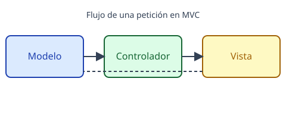

# Introducción

En esta unidad veremos cómo organizar una aplicación web en PHP usando el
patrón **MVC** (Modelo-Vista-Controlador) y por qué es la base de frameworks
como Laravel o Symfony.

:::note
MVC no es un framework: es una forma de **separar responsabilidades**.
:::

## Qué aprenderás

- Qué es un patrón de diseño.
- Las tres capas de MVC y sus responsabilidades.
- Cómo fluye una petición HTTP a través de la aplicación.

Sigue con [el patrón MVC](02-mvc.md).
