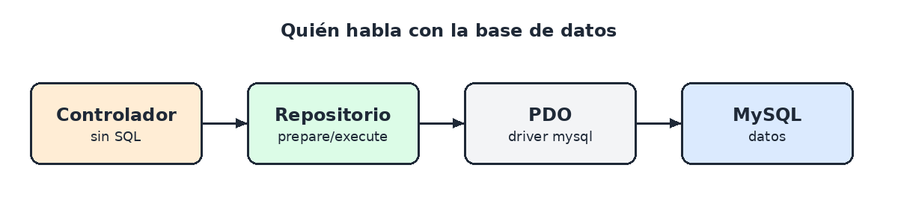

<!--

author:   Equipo DWES
title:    UT04 — La capa de acceso a datos con PDO
language: es
version:  2.0.1
comment:  Unidad de ejemplo del sistema Materiales Editables. Sentencias
          preparadas con PDO y organización de la capa de acceso a datos.

-->

# UT04 — La capa de acceso a datos con PDO

> Al terminar esta unidad serás capaz de conectar con una base de datos
> usando PDO, escribir consultas con sentencias preparadas y organizar el
> acceso a datos fuera de controladores y vistas.

## PDO en una frase

**PDO** (PHP Data Objects) es la interfaz estándar de PHP para hablar con
bases de datos de forma uniforme: mismo código para MySQL, PostgreSQL o
SQLite, y **sentencias preparadas** contra la inyección SQL.

## Conexión segura

```php
<?php
declare(strict_types=1);

function conectar(): PDO {
    $pdo = new PDO(
        'mysql:host=db;dbname=app;charset=utf8mb4',
        'app_user',
        'app_pass',
        [
            PDO::ATTR_ERRMODE => PDO::ERRMODE_EXCEPTION,   // errores como excepciones
            PDO::ATTR_DEFAULT_FETCH_MODE => PDO::FETCH_ASSOC,
            PDO::ATTR_EMULATE_PREPARES => false,           // prepares reales
        ]
    );
    return $pdo;
}
```

Las tres opciones importan: errores como **excepciones** (nunca avisos
silenciosos), fetch asociativo por defecto y prepares **reales** del motor.

## Sentencias preparadas: la regla de oro

Nunca concatenes datos del usuario en el SQL. Siempre marcadores:

```php
<?php
function buscarUsuario(PDO $pdo, int $id): ?array {
    $stmt = $pdo->prepare('SELECT id, nombre, email FROM usuarios WHERE id = :id');
    $stmt->execute(['id' => $id]);
    $usuario = $stmt->fetch();
    return $usuario === false ? null : $usuario;
}
```

| Marcador | Sintaxis | Cuándo |
|---|---|---|
| Con nombre | `:id`, `:email` | Consultas con varios parámetros |
| Posicional | `?` | Consultas cortas |

```php
<?php
function crearUsuario(PDO $pdo, string $nombre, string $email): int {
    $stmt = $pdo->prepare('INSERT INTO usuarios (nombre, email) VALUES (?, ?)');
    $stmt->execute([$nombre, $email]);
    return (int) $pdo->lastInsertId();
}
```

## Dónde vive este código

Siguiendo la UT03, estas funciones pertenecen al **modelo** (repositorio).
Ni la vista ni el controlador deberían ver un `PDO::prepare`:



```text
Controlador ──▶ UsuarioRepository ──▶ PDO ──▶ MySQL
     │                                   
     └── solo recibe arrays/objetos, nunca habla SQL
```

## Errores frecuentes

- Concatenar `$_GET` en el SQL → inyección SQL garantizada.
- No configurar `ERRMODE_EXCEPTION` → errores que nadie ve.
- Crear una conexión nueva en cada función → conéctate una vez y pásala.

## Autoevaluación

**1.** ¿Qué marcador es válido en una sentencia preparada PDO?

[( )] `$id`
[(X)] `:id`
[( )] `#id`
[[?]] Los marcadores con nombre empiezan por dos puntos.

**2.** Selecciona las prácticas correctas:

[[X]] Usar siempre sentencias preparadas con datos externos.
[[ ]] Concatenar el email si está validado con filter_var.
[[X]] Configurar PDO::ERRMODE_EXCEPTION.
[[X]] Devolver null (o lanzar) cuando no hay resultado, nunca false a secas.

**3.** Completa: «El acceso a la base de datos vive en la capa del
________».

[[modelo]]

## Para practicar

Escribe `listadoUsuarios(PDO $pdo, string $filtro): array` que busque por
nombre con `LIKE` usando marcadores. Pruébalo con el filtro
`%' OR '1'='1` y comprueba que no pasa nada.
