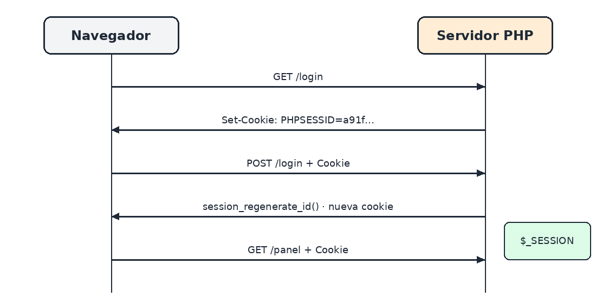

<!--

author:   Equipo DWES
title:    UT05 — Sesiones y cookies en PHP
language: es
narrator: Spanish Female
version:  1.0.0
comment:  Unidad de ejemplo del sistema Materiales Editables. Estado entre
          peticiones HTTP con cookies y sesiones, y sus riesgos de
          seguridad. Usa cajas, animaciones, narración y autoevaluación.

@nota
<div style="border-left: 4px solid #2e7d32; background: #edf7ee; padding: .6em 1em; margin: 1em 0">

**Nota:** @0

</div>
@end

@aviso
<div style="border-left: 4px solid #b26a00; background: #fff4e5; padding: .6em 1em; margin: 1em 0">

**Aviso:** @0

</div>
@end

@error
<div style="border-left: 4px solid #c62828; background: #fdecea; padding: .6em 1em; margin: 1em 0">

**Error frecuente:** @0

</div>
@end

-->

# UT05 — Sesiones y cookies en PHP

> Al terminar esta unidad serás capaz de mantener estado entre peticiones
> HTTP, elegir entre cookie y sesión según el dato, y proteger la sesión
> frente a los ataques más habituales.

## HTTP no recuerda nada

                                   --{{0}}--
HTTP es un protocolo sin estado: cada petición llega al servidor sin
memoria de las anteriores.

Cada petición HTTP es independiente. Para que una tienda «recuerde» el
carrito o una aplicación sepa quién ha iniciado sesión, el estado tiene
que viajar en cada petición o guardarse en el servidor con una clave que
viaje en cada petición.

| Mecanismo | Dónde se guarda el dato | Tamaño | Lo puede leer el usuario |
|---|---|---|---|
| Cookie | Navegador | ~4 KB por cookie | Sí |
| Sesión | Servidor (la cookie solo lleva el identificador) | Lo que admita el servidor | No |

## Cookies

Una cookie se crea con `setcookie()` **antes de enviar cualquier salida**
(viaja en las cabeceras de la respuesta) y está disponible en `$_COOKIE`
a partir de la **siguiente** petición.

```php
<?php
setcookie('tema', 'oscuro', [
    'expires'  => time() + 60 * 60 * 24 * 30, // 30 días
    'path'     => '/',
    'secure'   => true,     // solo por HTTPS
    'httponly' => true,     // inaccesible desde JavaScript
    'samesite' => 'Lax',    // no se envía en peticiones cruzadas POST
]);

$tema = $_COOKIE['tema'] ?? 'claro';
```

@aviso(`El usuario puede leer y modificar sus cookies: nunca guardes en ellas contraseñas, roles ni nada en lo que el servidor deba confiar.`)

## Sesiones

La sesión guarda los datos en el servidor y solo envía al navegador un
identificador aleatorio (por defecto, la cookie `PHPSESSID`).



```php
<?php
session_start();                       // siempre antes de usar $_SESSION

$_SESSION['visitas'] = ($_SESSION['visitas'] ?? 0) + 1;
echo "Visitas en esta sesión: {$_SESSION['visitas']}";
```

@error(`Llamar a **session\_start** después de haber enviado HTML: PHP ya no puede enviar la cabecera de la cookie y avisa con «headers already sent».`)

## Inicio y cierre de sesión seguros

                                   --{{0}}--
Veamos paso a paso qué hay que hacer al iniciar y al cerrar sesión.

    {{1}}
**Al iniciar sesión**, regenera el identificador para evitar la fijación
de sesión: el atacante no puede reutilizar un identificador que conocía
de antes.

{{2}}
************************************************************************
```php
<?php
session_start();
if (password_verify($clave, $usuario['hash'])) {
    session_regenerate_id(true);        // nuevo id, borra el anterior
    $_SESSION['usuario_id'] = $usuario['id'];
}
```
************************************************************************

    {{3}}
**Al cerrar sesión**, vacía los datos, destruye la sesión y caduca la
cookie del navegador.

{{4}}
************************************************************************
```php
<?php
session_start();
$_SESSION = [];
session_destroy();
setcookie(session_name(), '', ['expires' => time() - 3600, 'path' => '/']);
```
************************************************************************

                                   --{{4}}--
Con esto la sesión deja de existir tanto en el servidor como en el
navegador.

@nota(`**password\_verify** compara contra el hash creado con **password\_hash**; nunca guardes contraseñas en claro.`)

## Autoevaluación

**1.** ¿Dónde se guardan los datos de `$_SESSION`?

[( )] En una cookie del navegador
[(X)] En el servidor
[( )] En la URL
[[?]] El navegador solo recibe un identificador.

**2.** Marca las afirmaciones correctas:

[[X]] `setcookie()` debe llamarse antes de enviar cualquier salida.
[[ ]] Una cookie creada con `setcookie()` está en `$_COOKIE` en la misma petición.
[[X]] `session_regenerate_id(true)` protege frente a la fijación de sesión.
[[ ]] Guardar el rol del usuario en una cookie es seguro si se usa `httponly`.

**3.** Completa: la opción de cookie que impide leerla desde JavaScript
es [[ secure | (httponly) | samesite ]].

**4.** Clasifica cada dato:

[[Cookie] (Sesión)]
[  (X)      ( )   ]  Tema visual preferido por el usuario.
[  ( )      (X)   ]  Identificador del usuario autenticado.
[  ( )      (X)   ]  Contenido del carrito con precios calculados.

**5.** ¿Qué función destruye los datos de la sesión en el servidor?

[[session_destroy]]
[[?]] Empieza por `session_`.
************************************************************************
`session_destroy()` borra los datos en el servidor, pero **no** borra la
cookie del navegador ni vacía `$_SESSION` en la petición actual: por eso
el cierre de sesión también hace `$_SESSION = []` y caduca la cookie.
************************************************************************

## Tu opinión

¿Te ha quedado claro cuándo usar cookie y cuándo sesión?

[(1)] Nada claro
[(2)] Más o menos
[(3)] Muy claro

## Para practicar

Crea `login.php`, `privado.php` y `logout.php`. `privado.php` debe
redirigir a `login.php` si no hay `$_SESSION['usuario_id']`. Comprueba
con las herramientas del navegador que el valor de `PHPSESSID` cambia al
iniciar sesión.
